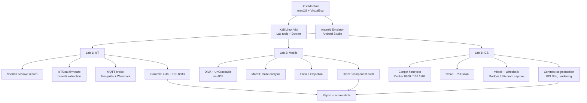

# Specialized-Security-Domains-Lab-IoT-Mobile-and-ICS
This lab is about defensive security analysis in three specialized domains: Internet of Things (IoT), Mobile, and Industrial Control Systems (ICS). 

Repository structure

security-domains-lab/
├── README.md
├── .gitignore
├── screenshots/
│   ├── 00-setup/
│   ├── 01-iot/
│   ├── 02-mobile/
│   └── 03-ics/
├── notes/
│   ├── iot-findings.md
│   ├── mobile-findings.md
│   └── ics-findings.md
├── configs/
│   └── secure.conf
└── report/
    └── report.md

README.md

# Specialized Security Domains Lab: IoT, Mobile and ICS

A hands-on, defensive-security lab covering three specialized domains: **Internet of Things (IoT)**, **Mobile**, and **Industrial Control Systems (ICS)**. All exercises ran against locally owned, isolated lab machines and intentionally vulnerable training targets. Shodan was used **passively only** (searching and reading results, never interacting with found devices).


## Lab architecture



## Scope and rules

- Only systems I own or have written permission to test were used.
- The lab network stayed isolated (host-only / NAT). No honeypots or vulnerable apps were exposed to the internet.
- Every finding is documented in `notes/` and `report/` using a consistent severity and recommendation format.

## Results summary

| Domain | Key findings | Status |
|---|---|---|
| IoT | Weak MD5-crypt password hashing, cracked `iotgoatuser` credential, plaintext MQTT topics readable on the wire, hardcoded secrets in firmware | Complete |
| Mobile | MobSF static analysis of DIVA; Frida/Objection and Drozer blocked on emulator ADB authorization (documented) | Partial |
| ICS | Modbus has no authentication or encryption; write commands accepted without credentials; **Docker Desktop for macOS silently drops loopback-only binding on port-remapped publishes** | Complete |

## Featured finding: Docker Desktop loopback-binding bug (ICS)

The strongest result of this lab was not the expected one. Conpot was launched with all three ports explicitly bound to `127.0.0.1`:

```bash
docker run -d --name conpot \
  -p 127.0.0.1:8800:8800 \
  -p 127.0.0.1:102:10201 \
  -p 127.0.0.1:502:5020 \
  honeynet/conpot
```

`docker port conpot` reported all three as loopback-only. An independent external Nmap scan from a second VM showed otherwise:

| Port | Expected | Observed externally |
|---|---|---|
| 8800 (HTTP, passthrough) | closed | closed — correctly restricted |
| 102 (S7comm, remapped) | closed | **open — exposed on all interfaces** |
| 502 (Modbus, remapped) | closed | **open — exposed on all interfaces** |

`lsof -i` confirmed the OS-level state: the passthrough port listened on `localhost` only, while both remapped ports listened on `*` (all interfaces), despite identical `-p 127.0.0.1:...` syntax.

**Root cause:** Docker Desktop's macOS network proxy (`com.docker.backend`) handles loopback-restricted bindings inconsistently depending on whether the host port matches the container's internal port. Remapped ports silently lose the loopback restriction, with no warning and no difference in `docker ps` / `docker port` output.

**Risk:** High. A control believed to be in place (network isolation) was silently absent for 2 of 3 published ports and would not have been discovered without independent external verification.

**Recommendation:** On Docker Desktop for macOS, do not rely on `-p 127.0.0.1:hostport:containerport` as a security boundary where host and container ports differ. Match port numbers where possible, add an independent host firewall rule (macOS `pf`), or run ICS honeypot labs on native Linux Docker.


## IoT lab: plain text versus encrypted MQTT

The strongest before/after evidence in the IoT lab: the same message, first in plaintext, then over TLS with authentication.


*Figure 8: Topic and message are readable before TLS was enabled.*


*Figure 13: The same traffic is unreadable after enabling TLS on port 8883.*

## Verification checklist

- [x] Shodan statistics recorded (passive only)
- [x] Firmware extracted, 3+ findings listed (weak hashes, cracked password, hardcoded secrets)
- [x] MQTT traffic captured in plain text
- [x] MQTT secured with authentication and TLS
- [ ] MobSF report generated and reviewed
- [ ] Frida server running and Objection connected (blocked: ADB authorization)
- [ ] Drozer attack surface listed (blocked: same ADB issue)
- [x] Conpot running and scanned
- [x] Modbus traffic captured and write filter created
- [x] Zone and conduit table completed

## Tools and targets

| Tool | Purpose |
|---|---|
| VirtualBox + Kali Linux | Isolated lab platform |
| Docker | MobSF and Conpot |
| Wireshark | Protocol analysis (MQTT, Modbus/TCP, S7comm, TLS) |
| binwalk | Firmware extraction (IoTGoat) |
| Nmap + scripts | Service discovery, `modbus-discover`, `s7-info` |
| mbpoll / mosquitto-clients | Protocol clients for ICS and IoT testing |
| Shodan | Passive exposure research only |
| Android Studio, adb, Frida, Objection, Drozer | Mobile testing |

| Target | Domain | Source |
|---|---|---|
| OWASP IoTGoat | IoT | github.com/OWASP/IoTGoat |
| Eclipse Mosquitto | IoT | apt package |
| DIVA, UnCrackable Level 1 | Mobile | OWASP MASTG Crackmes, payatu DIVA |
| Conpot | ICS | Docker image `honeynet/conpot` |

## References

- OWASP IoT Security, OWASP MASTG / MASVS
- NIST SP 800-82 (ICS Security)
- IEC 62443 (zones and conduits)
- GSMA IoT Security Guidelines, IoT Security Foundation
- *Practical IoT Hacking* (Chantzis et al.), *Android Security Internals* (Elenkov), *Industrial Network Security* (Knapp & Langill)

## Repository layout

| Path | Contents |
|---|---|
| `screenshots/` | Numbered evidence images, one per lab step |
| `notes/` | Findings tables as Markdown text |
| `configs/` | Lab configuration files (no passwords or keys) |
| `report/` | Final structured report |

.gitignore

*.img
*.bin
*.apk
_*.extracted/
*.key
*.pem
passwd
*.pcapng
.DS_Store

notes/ics-findings.md

# ICS Lab Findings

## Finding ICS-01
**Domain:** ICS
**Title:** Conpot honeypot successfully deployed and scanned
**Evidence:** screenshots/03-ics/01-ics-conpot-running.png, 03-ics-nmap-service-scan.png, 04-ics-nmap-ics-scripts.png
**Impact:** Confirms a realistic target was available for testing ICS protocol exposure; Nmap identified open Modbus (502), S7comm (102), and HTTP (8800) services, consistent with a real Siemens-style PLC.
**Severity:** Informational
**Recommendation:** N/A (test setup confirmation)
**Reference:** NIST SP 800-82

## Finding ICS-02
**Domain:** ICS
**Title:** Modbus protocol has no authentication; read and write commands both process without credentials
**Evidence:** screenshots/03-ics/06-ics-mbpoll-read.png, 07-ics-wireshark-modbus.png, 08-ics-wireshark-write-filter.png
**Impact:** Any actor who can reach port 502 can read device registers and attempt write commands (function codes 5, 6, 15, 16) with zero authentication or encryption. A Write Single Register command (function code 6) was sent with zero credentials and was processed, returning only a protocol-level exception due to an invalid address, not any access check.
**Severity:** High
**Recommendation:** Segment ICS networks per IEC 62443 zone/conduit model; place Modbus traffic behind a gateway that enforces authentication; monitor for write function codes using an IDS signature matching `modbus.func_code == 5 || 6 || 15 || 16`.
**Reference:** NIST SP 800-82, IEC 62443

## Finding ICS-03
**Domain:** ICS
**Title:** Loopback-only binding silently fails for port-remapped Docker publishes on Docker Desktop for macOS
**Evidence:** screenshots/03-ics/09-ics-exposure-test.png; lsof -i output in notes
**Impact:** Despite explicit `-p 127.0.0.1:...` bindings on all three published ports, ports 102 and 502 (remapped) listened on all interfaces and were reachable from a second machine, while 8800 (passthrough) correctly stayed loopback-only. A security control believed in place was silently absent, with no warning in `docker ps` or `docker port`.
**Severity:** High
**Recommendation:** Never trust configuration alone; verify every restricted binding with independent external scanning. Add host firewall rules as a second layer. Match host and container port numbers, or run ICS honeypot labs on native Linux Docker.
**Reference:** NIST SP 800-82 (defense in depth, monitoring)

## Part E: NIST SP 800-82 mini assessment

| Area | Observation from the lab | Risk | Recommendation |
|---|---|---|---|
| Authentication | Modbus has none; a write command was processed with zero credentials | High | Segment the network; use gateways/proxies that add an authentication layer in front of the protocol |
| Encryption | All observed traffic was cleartext; function codes, register addresses and values readable in plain hex | High | Use VPN or secure tunnels (IPsec, stunnel) between zones |
| Exposure | Despite 127.0.0.1-only binding, ports 102 and 502 were reachable from another machine (Docker Desktop macOS remapping inconsistency) | High | Verify every restricted binding externally; add host firewall rules; consider native Linux Docker |
| Monitoring | No alerting by default; a write attempt would have gone unnoticed without manually watching Wireshark | High | Deploy IDS/IPS (Suricata, Zeek) on a tap/SPAN port with a signature for Modbus write function codes 5/6/15/16 |

## Control 2: IEC 62443 zones and conduits

| Zone | Devices | Allowed communication (conduit) |
|---|---|---|
| Enterprise (IT) | Office PCs, email | Only to the DMZ |
| DMZ | Historian, remote access gateway | To the control zone on specific ports only |
| Control | PLCs, HMIs | Only from engineering workstation and HMIs |
| Safety | Safety controllers | Isolated, no inbound from IT |

## Control 3: Monitoring sentence

A security team would deploy an IDS such as Suricata or Zeek on a network tap or SPAN port, with a signature matching `modbus.func_code == 5 || 6 || 15 || 16` to generate real-time alerts on any Modbus write attempt.

## Control 4: Hardening checklist

- [x] Change default passwords on all devices
- [x] Disable unused services and ports
- [x] Restrict remote access to a VPN with multi-factor authentication
- [x] Keep an up-to-date asset inventory
- [x] Back up PLC programs and configurations offline
- [x] Patch with a tested, scheduled process

## Cleanup

Container stopped and removed after lab completion (`docker stop conpot && docker rm conpot`). No screenshot needed; teardown only.

notes/iot-findings.md

# IoT Lab Findings

## Finding IOT-01
**Domain:** IoT
**Title:** IoTGoat firmware uses weak MD5-crypt password hashing
**Evidence:** screenshots/01-iot/05-iot-passwd-shadow.png
**Impact:** The `/etc/shadow` entries use MD5-crypt, a fast, outdated hash. An attacker with firmware access can crack credentials offline in minutes; the `iotgoatuser` password was cracked during the lab.
**Severity:** High
**Recommendation:** Use modern adaptive hashing (yescrypt/argon2) and unique per-device credentials.
**Reference:** OWASP IoT Top 10, NIST SP 800-63B

## Finding IOT-02
**Domain:** IoT
**Title:** Sensitive files and hardcoded secrets present in extracted firmware
**Evidence:** screenshots/01-iot/06-iot-hardcoded-secrets.png
**Impact:** Anyone with the firmware image can read config files, private keys, and passwords shared across every device of the model.
**Severity:** High
**Recommendation:** Remove secrets from images; provision per-device credentials at manufacturing/first boot.
**Reference:** OWASP IoT Security

## Finding IOT-03
**Domain:** IoT
**Title:** MQTT traffic readable in plain text (topics and payloads)
**Evidence:** screenshots/01-iot/07-iot-mqtt-subscriber.png, 08-iot-wireshark-mqtt-plaintext.png
**Impact:** An attacker on the same network can read smart-home topics such as `home/door/lock` and inject messages.
**Severity:** High
**Recommendation:** Enforce TLS (port 8883), disable anonymous access, require per-client credentials.
**Reference:** OWASP IoT Security

## Finding IOT-04
**Domain:** IoT
**Title:** Authentication and TLS controls verified working
**Evidence:** screenshots/01-iot/11-iot-anonymous-denied.png, 12-iot-authenticated-ok.png, 13-iot-wireshark-tls-encrypted.png
**Impact:** After adding `mosquitto_passwd` credentials and a self-signed TLS certificate on port 8883, anonymous publishes are rejected and payloads are unreadable in Wireshark.
**Severity:** Informational (control verification)
**Recommendation:** N/A
**Reference:** OWASP IoT Security

## Part A note: Shodan passive research
Searched `product:mosquitto` on Shodan (read-only). Recorded total result count, top countries, ports and organizations. Checked own public IP for exposure. No device was opened, logged into, or scanned.

notes/mobile-findings.md

# Mobile Lab Findings

## Status
- Part A (emulator + app install): done
- Part B (MobSF static analysis): in progress
- Part C (Frida/Objection): blocked on ADB/emulator authorization issue
- Part D (Drozer): client installed, Agent APK downloaded; blocked on same ADB issue
- Part E (auth review + MASVS table): conceptual table drafted; pending live app access

## MASVS mapping (draft, to confirm with live DIVA testing)

| MASVS area | Secure practice |
|---|---|
| Storage | Android Keystore and encrypted storage, never plain text |
| Crypto | Modern algorithms, no hardcoded keys |
| Auth | Validate on the server, short-lived tokens, biometric prompts |
| Network | Enforce TLS with certificate validation, disable cleartext traffic |
| Platform | Do not export components unnecessarily, `allowBackup=false` |
| Resilience | Disable debugging in release builds |

## Troubleshooting log
- `adb devices` empty: restart emulator, then `adb kill-server && adb start-server`
- `frida-ps -U` fails: Frida client and server versions must match exactly

Push it to GitHub

mkdir -p security-domains-lab/{screenshots/{00-setup,01-iot,02-mobile,03-ics},notes,configs,report}
cd security-domains-lab
